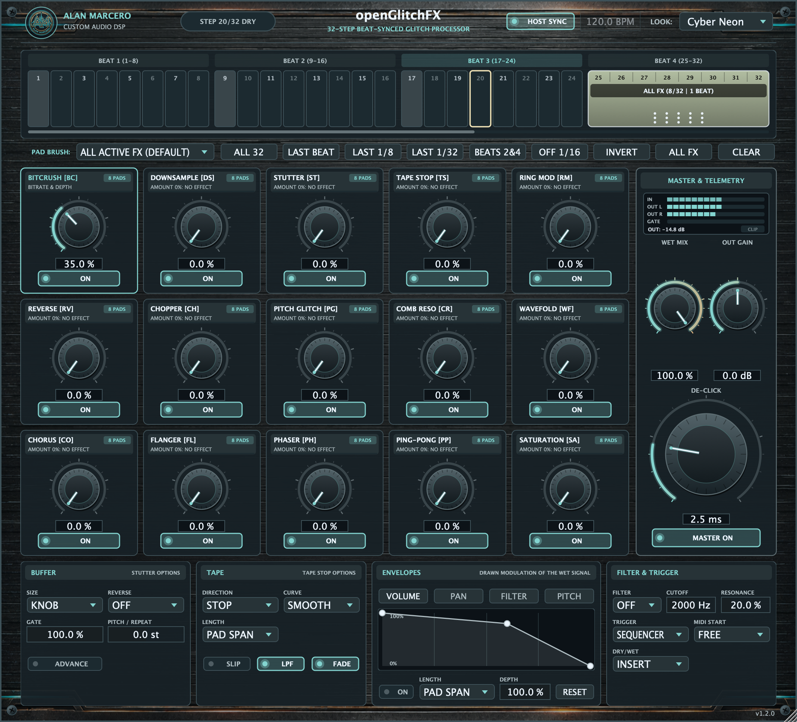
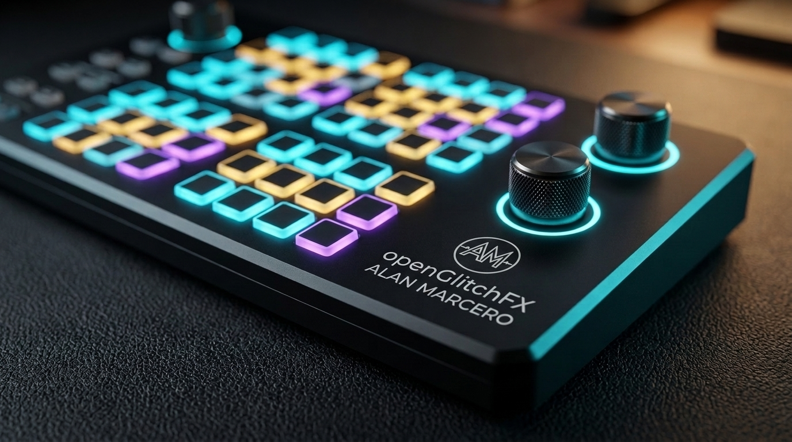
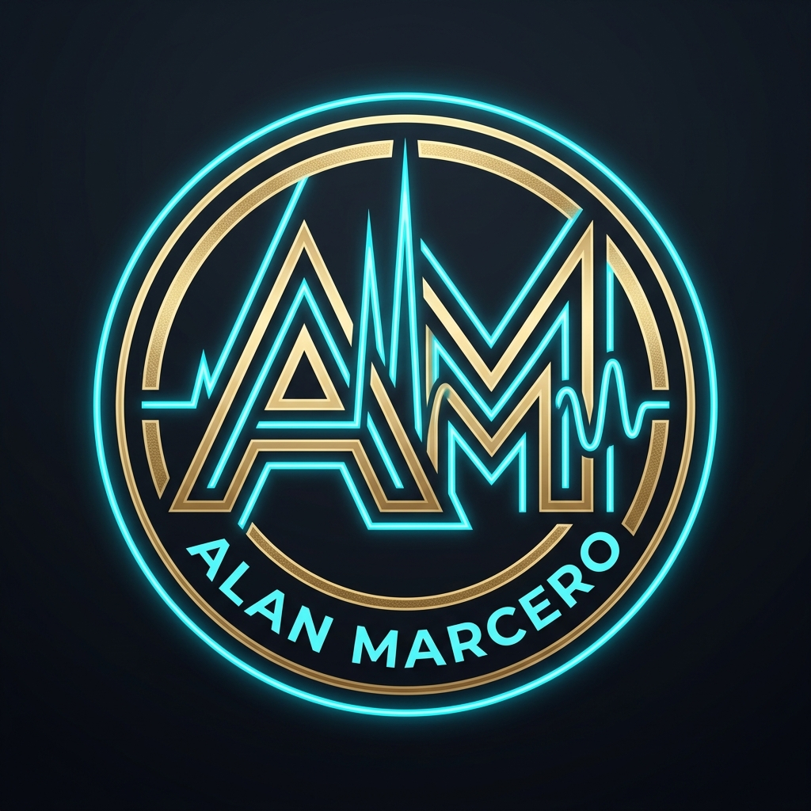

# openGlitchFX

[Install with OpenVST Manager](https://github.com/alanmarcero/alan-m-OpenVSTManager/releases/latest)



*Captured from the native v1.2.0 VST3 editor. [Capture details and provenance](docs/SCREENSHOTS.md).*

Beat-synced glitch processor with 15 effects and a 32-step sequencer. Pads that are on process audio. The rest pass dry. Output trim still applies to the dry signal. Transitions are smoothed.

---

## Interface and themes

The native editor has four selectable color themes: **Cyber Neon** (default), **Industrial Amber**, **Acid Matrix**, and **Arctic Glitch**. The theme is saved with the session and can be automated.

### Hardware inspiration

These generated concept images show the hardware inspiration and branding; they are not plugin screenshots.

| Studio hardware concept | Alan Marcero emblem |
| :---: | :---: |
|  |  |

---

## Sequencer

A 4/4 bar is 32 steps: 8 steps per beat, each 1/32 of a bar. The sequencer follows host PPQ and BPM, or the internal BPM when host sync is off or the host reports no tempo.

Adjacent pads with the same FX routing draw as one block and run as one span. The effect does not restart on each 1/32 step. Badges show the span, for example `ALL FX (8/32 | 1 BEAT)` or `TAPE STOP (4/32 | 1/8 BAR)`. Tape Stop and Reverse use that full span, including across the bar line. Stutter captures once per run and repeats its slice. Chopper and Pitch Glitch keep their modulation.

Each pad stores a 15-bit FX mask (the original ten bits plus five more) and its own smoothed gate, so neighboring pads can run different effects. Right-click a pad or block to:

- enable all 15 effects, or disable the pad so it passes dry
- solo one effect (`Only BITCRUSH (BC)`, `Only TAPE STOP (TS)`, and the rest). If that effect's amount is 0%, it is set to 50%
- toggle any combination of the 15 effects
- split one 1/32 pad out of a block
- copy the routing to the current 8-step beat, or to all 32 pads

The pad-brush menu is `ALL ACTIVE FX` or one effect from `ONLY: BITCRUSH [BC]` through `ONLY: SATURATION [SA]`. Left-click and drag to paint that choice. Adjacent painted pads merge. Each pad shows a routing badge (`ALL FX (8/32 | 1 BEAT)`, `BC 2/32`, `TS`, `3FX`) and a 3×5 grid of which effects are on.

| Button | Pads |
| --- | --- |
| ALL 32 | All 32 pads on |
| LAST BEAT (25-32) | Beat 4 only |
| LAST 1/8 (29-32) | The last eighth note (4 steps) |
| LAST 1/32 | Step 32 only |
| BEATS 2&4 | Beats 2 and 4 |
| OFF 1/16 | The second 1/16 of every 1/8 |
| ALL FX | All 15 effects routed to every pad. Pad on/off stays as it is |
| CLEAR | All pads off |

De-click fade is 0.5 ms to 25 ms, used when a pad turns on or off and when adjacent pads use different effects. Stutter, Tape Stop and Reverse capture on the sample where that effect's pad goes from off to on.

---

## Effects

Each effect has an amount knob (0–100%) and its own on/off switch. At 0% that effect is silent, including on pads routed to it. Effects that are on run in series on an active pad.

1. **Bitcrush.** Bit depth from 16-bit to 1.5-bit, with packet-hold decimation and tanh compensation.
2. **Downsample.** Sample-and-hold divider from 1× to 59×.
3. **Stutter.** Captures at the start of an active region and loops a slice with smoothed edges. In Knob mode the slice runs from a quarter note (capped at 500 ms) down to 22 ms. Buffer Size can lock the slice to a tempo division.
4. **Tape stop.** Playback speed and pitch decelerate to a low-speed floor.
5. **Ring mod.** Sine carrier from 45 Hz to 1600 Hz.
6. **Reverse.** Plays the preceding pad span backwards, up to 12 seconds, with raised-cosine edge fades. On a cold start it passes dry audio until a full region is captured. Adjacent pads do not retrigger short grains.
7. **Chopper.** Tempo-scaled raised-cosine gate. Amount changes rate, depth and shape. Longer joined spans slow the gate. High amounts add a stereo phase offset.
8. **Pitch glitch.** Dual-head crossfaded granular shifter cycling toward +7, +12, −12 and +19 semitones. Full amount reaches those intervals. Lower settings reduce the shifts.
9. **Comb.** Delay from 1.4 ms to 14 ms with high, soft-clipped feedback.
10. **Wavefold.** Sine wavefolder with first-order antiderivative antialiasing, DC blocking and a tone filter.
11. **Chorus.** Two modulated delay voices per channel.
12. **Flanger.** Short fractional delay with damped feedback.
13. **Phaser.** Six swept allpass stages, with a stereo offset.
14. **Ping-pong.** Tempo-synced eighth-note echoes alternating left and right. The delay keeps time through dry pads. Repeats are heard on active pads.
15. **Saturation.** Gain-compensated tanh drive with antiderivative antialiasing and DC removal.

The editor can be resized. New effects start at 0%, so older sessions retain their sound. [Algorithm sources and verification](docs/DSP.md) · [Release changes](CHANGELOG.md).

---

## Buffer, tape, envelopes and MIDI

The panel below the FX cards adds four groups of controls.

- **BUFFER (STUTTER options):**
  - **SIZE:** `KNOB` lets the STUTTER amount set the slice. `1/4` to `1/64` locks the slice to the tempo.
  - **REVERSE:** `OFF`, `ALL` repeats, or `ALTERNATE` repeats.
  - **GATE:** The audible part of each repeat (`5%` to `100%`).
  - **PITCH / REPEAT:** Pitch change per repeat (`-12` to `+12` semitones).
  - **ADVANCE:** Each repeat starts half a slice later, so the stutter moves forward through the audio.
- **TAPE (TAPE STOP options):**
  - **DIRECTION:** `STOP` slows the tape toward its low-speed floor. `START` ramps from that floor to normal speed.
  - **CURVE:** `SMOOTH` ramp or `STEPPED` (8 speed steps).
  - **LENGTH:** `PAD SPAN` or a fixed note length (`1/32` to `1 BAR`).
  - **SLIP:** Wow and flutter. **LPF:** Highs roll off as the tape slows. **FADE:** Volume drops as the tape slows.
- **ENVELOPES:** Four drawn envelopes (`VOLUME`, `PAN`, `FILTER`, `PITCH`) shape the wet signal.
  - Click to add a point, drag to move it, double-click or right-click to delete it. `RESET` restores the default shape.
  - **LENGTH:** `PAD SPAN` runs the envelope once across each block of joined pads. A note value loops it in time with the song.
  - `PITCH` changes the STUTTER playback pitch by up to one octave. `FILTER` moves the cutoff down by up to 8 octaves.
  - The session saves the drawn points.
- **FILTER & TRIGGER:**
  - **FILTER:** Low-pass or high-pass state-variable filter on the wet signal, with `CUTOFF` and `RESONANCE`.
  - **TRIGGER:** `SEQUENCER` uses the 32 pads. `MIDI` ignores the pads: notes `60`-`74` trigger one FX each (BITCRUSH to SATURATION), and any other note triggers all FX.
  - **MIDI START:** `FREE` starts on the note. `SYNCED` waits for the next `1/32` step.
  - **DRY/WET:** `INSERT` replaces the dry signal on active pads. `PARALLEL` keeps the dry signal and adds the glitch on top.

Hover over any control for a tooltip.

---

## Project Structure

```
openGlitchFX/
├── .github/
│   └── workflows/
│       └── build.yml                  # macOS Universal + Windows MSVC CI, CTest & pluginval
├── assets/
│   ├── alan_marcero_logo.jpg          # Custom Alan Marcero emblem (embedded in plugin & README)
│   ├── analog-cyber-faceplate.png      # Generated machined-metal texture (embedded in BinaryData)
│   ├── native-ui.png                  # Released VST3 editor capture
│   └── studio_hardware.jpg            # Studio hardware macro concept shot
├── Source/
│   ├── Core/                          # Pure C++20 DSP engine (zero GUI dependencies)
│   │   ├── BeatStepSequencer.h/.cpp   # 32-step 4/4 bar PPQ sync & anti-click gate envelope
│   │   ├── GlitchEffects.h/.cpp       # All 15 DSP glitch effect processors + wet filter
│   │   ├── ModEnvelope.h/.cpp         # Drawn n-point modulation envelopes
│   │   └── GlitchProcessorCore.h/.cpp # Master glitch chain & telemetry
│   └── Plugin/                        # JUCE 8 VST3 Plugin & GUI
│       ├── Parameters.h/.cpp          # APVTS layout (32 steps + 15 FX + master controls)
│       ├── GlitchLookAndFeel.h/.cpp   # 4 selectable themes & custom rotary/button rendering
│       ├── StepSequencerComponent.h/.cpp # Interactive 32-step 4/4 beat grid UI
│       ├── DetailPanelComponent.h/.cpp   # Buffer, tape, envelope, filter & trigger controls
│       ├── EnvelopeEditorComponent.h/.cpp # Breakpoint envelope editor
│       ├── PluginProcessor.h/.cpp     # JUCE AudioProcessor & playhead integration
│       └── PluginEditor.h/.cpp        # 15-FX 3x5 matrix + 32-step sequencer editor
├── Tests/                             # Catch2 unit test suite
│   ├── BeatSequencerTests.cpp
│   ├── GlitchCoreTests.cpp
│   └── PluginStateTests.cpp
├── CMakeLists.txt
├── LICENSE
└── README.md
```

---

## Install

1. Download and install [OpenVST Manager](https://github.com/alanmarcero/alan-m-OpenVSTManager/releases/latest) for macOS or Windows.
2. Open the manager and refresh the catalog.
3. Choose **openGlitchFX**, select **VST3**, and install.
4. Rescan plugins in your DAW. If you chose a custom install folder, add it to the DAW's search paths.

Manual downloads: [v1.2.1 release](https://github.com/alanmarcero/openGlitchFX/releases/tag/v1.2.1). Packages contain **VST3 only** for macOS 11+ (universal Apple Silicon/Intel) and Windows x64. Extract and copy the entire `openGlitchFX.vst3` bundle to `~/Library/Audio/Plug-Ins/VST3/` on macOS or `C:\Program Files\Common Files\VST3\` on Windows, then rescan your DAW. macOS builds are signed ad hoc.

## Building & Testing

### Prerequisites

CMake 3.22+, Git, and a C++20 compiler (Xcode command-line tools on macOS or Visual Studio 2022 C++ tools on Windows). The first configure downloads JUCE 8.0.9 and Catch2 3.9.1.

### Build Commands
```bash
cmake -S . -B build -DCMAKE_BUILD_TYPE=Release
cmake --build build --config Release --parallel
ctest --test-dir build -C Release --output-on-failure
```

Outputs are in `build/openGlitchFX_artefacts/Release/VST3/`. Add `-DCMAKE_OSX_ARCHITECTURES="arm64;x86_64" -DCMAKE_OSX_DEPLOYMENT_TARGET=11.0` when configuring a universal macOS build; use `-A x64` with the Visual Studio generator on Windows. CI builds and validates the VST3 on macOS and Windows.

---

## License

MIT License. Copyright (c) 2026 Alan Marcero.
