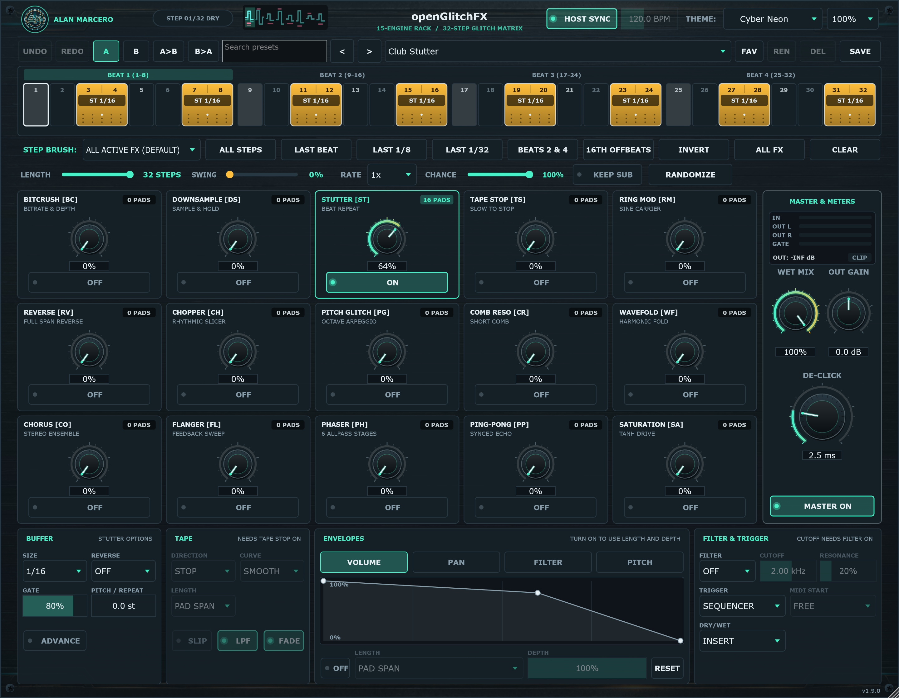

# openGlitchFX

Create beat-synced glitches with a 32-step sequencer. Choose from 15 effects and route them to any step.

[Install with OpenVST Manager](https://github.com/alanmarcero/alan-m-OpenVSTManager/releases/latest) · [Download v1.7.0](https://github.com/alanmarcero/openGlitchFX/releases/tag/v1.7.0)

*Native editor capture. [See capture details](docs/SCREENSHOTS.md).*

## Sequencer

The 32-step pattern spans one 4/4 bar. Each step lasts one 32nd note. Set the loop length from 1 to 32 steps. The sequencer follows host tempo, or uses the internal clock when host sync is off or unavailable.

Set Swing to delay offbeat steps. Randomize with Light (35%), Medium (55%), or Wild (75%) density. Use preset buttons for ALL STEPS, LAST BEAT, LAST 1/8, LAST 1/32, BEATS 2 & 4, 16TH OFFBEATS, and CLEAR. ALL FX routes every effect through steps that are already on.

Each step can pass audio dry or route one or more effects. Drag across steps to paint an effect choice. Right-click a step to enable all effects, solo one, or toggle a combination. You can also split a step or copy its routing to the current beat or all 32 steps. Adjacent steps with matching routing form a longer effect span.

## Effects

Each effect has an on/off switch and Amount control. An effect at 0% is silent. Effects run in series on active steps.

- **Bitcrush:** Reduce bit depth.
- **Downsample:** Reduce sample rate.
- **Stutter:** Capture and repeat a slice of audio.
- **Tape Stop:** Slow down or build up playback speed.
- **Ring Mod:** Add a metallic tone.
- **Reverse:** Play recent audio backward.
- **Chopper:** Gate audio in a rhythm.
- **Pitch Glitch:** Shift pitch.
- **Comb:** Add a short ringing tone.
- **Wavefold:** Add a rough, buzzy tone.
- **Chorus:** Widen sound with moving copies.
- **Flanger:** Add a moving short delay.
- **Phaser:** Add a moving filter sweep.
- **Ping-Pong:** Add tempo-synced eighth-note echoes between channels.
- **Saturation:** Add drive and density.

## Performance controls

- **Stutter:** Select KNOB to use Amount for slice size. Or choose a tempo division from 1/4 to 1/64 note. Set Reverse to Off, All, or Alternate. Adjust gate length, pitch change, and slice advance.
- **Tape Stop:** Choose Start or Stop, Smooth or Stepped motion, and a pad span or note length from 1/32 note to one bar. Slip adds wow and flutter. The low-pass filter removes highs as the effect slows. Fade lowers the volume.
- **Envelopes:** Draw Volume, Pan, Filter, and Pitch shapes. Click to add points, drag to move them, and double-click or right-click to delete them. Reset a shape to its default. Set each shape to span joined steps or loop to a note length. Pitch changes Stutter pitch by up to one octave. Filter moves its cutoff down by up to eight octaves.
- **Filter and trigger:** Add a low-pass or high-pass filter to the wet signal. Set cutoff and resonance. Choose Sequencer or MIDI trigger. In MIDI mode, notes 60–74 trigger individual effects, and other notes trigger all effects. MIDI Start can run freely or wait for the next step.
- **Dry and wet:** Choose Insert to replace the dry signal on active steps. Choose Parallel to mix the effect with the dry signal.
- **Transitions:** Set the fade between steps from 0.5 to 25 ms. Output trim also affects dry audio.

## Themes and compatibility

An eight-slice waveform in the header jumps one slice every 1/32 note. Host Sync follows the DAW’s beat, including tempo changes and loop jumps, and holds the last slice when stopped. When the host provides no clock or Host Sync is off, the rack uses its internal BPM.

Choose Cyber Neon, Industrial Amber, Acid Matrix, or Arctic Glitch. The theme and drawn envelopes save with the session. The theme also supports host automation.

The VST3 plugin follows host tempo and MIDI. It supports macOS 11 or later on Apple Silicon and Intel, and Windows x64. Packages include VST3 only.

Install with [OpenVST Manager](https://github.com/alanmarcero/alan-m-OpenVSTManager/releases/latest) or download the [v1.7.0 release](https://github.com/alanmarcero/openGlitchFX/releases/tag/v1.7.0). Rescan your DAW after installation. See [release changes](CHANGELOG.md).

## License

openGlitchFX uses the MIT license. See [LICENSE](LICENSE).
