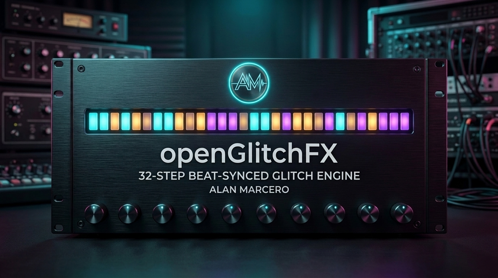
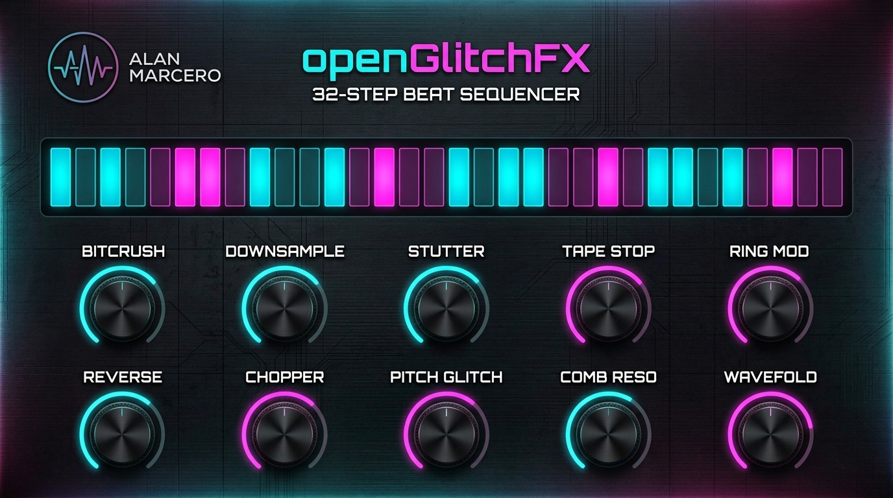
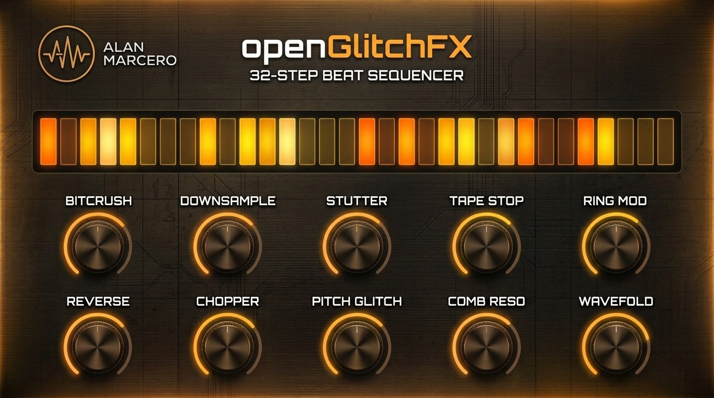

# openGlitchFX



**openGlitchFX** is a beat-synchronized multi-glitch VST3 audio processor by **Alan Marcero**.

Unlike traditional glitch plugins that run continuously or require complex MIDI routing and automation lanes, **openGlitchFX** features an integrated **32-Step 4/4 Bar Beat-Synced Enable/Disable Sequencer**. Leave the plugin enabled on your drum bus, synth lead, or master track, and select any of the **32 spots in a 4/4 bar** (down to a single `1/32` note, the last beat of a bar, or custom rhythmic patterns) where the glitch engine engages—passing 100% pristine dry audio everywhere else with click-free micro-crossfade smoothing.

---

## Interface & Look Themes

### 1. Cyber Neon Edition (Default)
*Anodized obsidian & brushed gunmetal faceplate, electric cyan and neon magenta LED arcs, 32-step beat sequencer bar, and 10 rotary glitch modules.*


### 2. Industrial Amber Edition
*Brushed bronze and dark charcoal chassis with incandescent warm amber/orange LED indicators and 32-step sequencer pads.*


### 3. Hardware Controller Inspiration & Custom Branding
| Studio Hardware Concept | Custom Alan Marcero Emblem |
| :---: | :---: |
|  |  |

---

## Core Differentiator: 32-Step 4/4 Beat-Synced Sequencer

- **32 Selectable Spots per 4/4 Bar:**
  - Every 4/4 bar (4 quarter-note beats) is subdivided into **32 steps** (`8 steps per beat × 4 beats = 32 steps`, each representing `1/32` of a bar).
  - Click or drag across any of the 32 pads in the sequencer to toggle glitch processing **ON** or **OFF** for that exact `1/32` slice of the bar.
- **One-Click Musical Pattern Presets:**
  - **ALL 32:** Continuous glitch processing across the entire bar.
  - **LAST BEAT (25-32):** Engages only on Beat 4 of every bar for automatic end-of-bar turnarounds and fills.
  - **LAST 4 STEPS (29-32):** Engages for the final half-beat (`4/32`) of the bar.
  - **LAST 1/32 (Step 32):** Micro-glitch burst on only the very last `1/32` note of the bar.
  - **BEATS 2 & 4:** Backbeat-synced glitching on snare beats.
  - **1/16 ALT:** Alternating 16th-note rhythmic gating.
  - **INVERT / CLEAR:** Instant pattern manipulation.
- **Sample-Accurate DAW Sync & Anti-Click Gate Envelope:**
  - Locks directly to the DAW host playhead (`PPQ` bar position and `BPM`) or runs on an internal BPM clock when host transport is stopped.
  - Adjustable **DE-CLICK** smoothing (`0.5 ms` to `25 ms`) ensures zero pops or clicks when transitioning between dry pass-through and active glitch steps.
  - Automatically triggers buffer capture for time-based effects (`STUTTER`, `TAPE STOP`, `REVERSE`) on the exact sample a disabled-to-enabled step boundary is crossed.

---

## 10 Glitch FX Modules (Phase 1 + Phase 2)

Each of the **10 Glitch FX** features a dedicated **Amount Knob (`0% – 100%`)** and an independent **ON/OFF** toggle so you can dial in a single effect or stack multiple glitch processors in series:

### Phase 1 — Core 5 Glitch FX
1. **BITCRUSH (Bitrate & Depth Crusher):**
   - Continuously variable knob that dials bit resolution from pristine 16-bit down to gritty 1.5-bit quantization, paired with bitrate packet-hold frame decimation and tanh saturation compensation.
2. **DOWNSAMPLE (Sample Rate Decimator):**
   - Variable sample-and-hold clock divider (`1x` to `56x`) for authentic early-sampler aliasing and vocal/synth crunch.
3. **STUTTER (Beat Repeat / Buffer Stutter):**
   - Captures audio at the start of an active step region and loops rhythmic micro-slices (`1/8` beat down to `8 ms` buzz-saw grains) with raised-cosine anti-click windowing.
4. **TAPE STOP (Vinyl Brake):**
   - Simulates pressing a finger against a spinning tape reel or turntable platter, decelerating playback speed and pitch smoothly to a halt.
5. **RING MOD (Cybernetic Carrier Modulator):**
   - Exponentially swept sine carrier oscillator (`45 Hz` to `1600 Hz`) for metallic, robotic, and sci-fi harmonic textures.

### Phase 2 — 5 Additional Glitch FX
6. **REVERSE (Backwards Grain Player):**
   - Real-time circular buffer grain reverser that flips incoming audio backwards across Hanning-windowed slices (`220 ms` down to `35 ms`).
7. **CHOPPER (Rhythmic Slicer Gate):**
   - High-speed tempo-scaled square/trance chopper (`4 Hz` to `48 Hz`) with variable duty cycle and staccato depth.
8. **PITCH GLITCH (Octave & Fifth Arpeggiator):**
   - Dual-head crossfaded granular pitch shifter that jumps across stepped glitch intervals (`+7`, `+12`, `-12`, `+19` semitones).
9. **COMB RESO (Metallic Feedback Resonator):**
   - Short-delay (`1.4 ms` to `14 ms`) high-feedback comb filter with soft-clipped feedback loop for metallic flanging and tuned tube resonances.
10. **WAVEFOLD (Harmonic Digital Wavefolder):**
    - Multi-stage trigonometric wavefolder (`sin(drive × x)`) that folds waveform peaks back into complex harmonic overtones.

---

## Project Structure

```
openGlitchFX/
├── .github/
│   └── workflows/
│       └── build.yml                  # macOS Universal + Windows MSVC CI, CTest & pluginval
├── assets/
│   ├── alan_marcero_logo.jpg          # Custom Alan Marcero emblem (embedded in plugin & README)
│   ├── plugin_backdrop.jpg            # Dark cyber-hardware texture (embedded in plugin BinaryData)
│   ├── banner.jpg                     # 16:9 README hero banner
│   ├── gui_cyber_neon.jpg             # Cyber Neon UI theme showcase
│   ├── gui_industrial_amber.jpg       # Industrial Amber UI theme showcase
│   └── studio_hardware.jpg            # Studio hardware macro concept shot
├── Source/
│   ├── Core/                          # Pure C++20 DSP engine (zero GUI dependencies)
│   │   ├── BeatStepSequencer.h/.cpp   # 32-step 4/4 bar PPQ sync & anti-click gate envelope
│   │   ├── GlitchEffects.h/.cpp       # All 10 DSP glitch effect processors
│   │   └── GlitchProcessorCore.h/.cpp # Master glitch chain & telemetry
│   └── Plugin/                        # JUCE 8 VST3 Plugin & GUI
│       ├── Parameters.h/.cpp          # APVTS layout (32 steps + 10 FX + master controls)
│       ├── GlitchLookAndFeel.h/.cpp   # 4 selectable themes & custom rotary/button rendering
│       ├── StepSequencerComponent.h/.cpp # Interactive 32-step 4/4 beat grid UI
│       ├── PluginProcessor.h/.cpp     # JUCE AudioProcessor & playhead integration
│       └── PluginEditor.h/.cpp        # 10-FX 2x5 matrix + 32-step sequencer editor
├── Tests/                             # Catch2 unit test suite
│   ├── BeatSequencerTests.cpp
│   └── GlitchCoreTests.cpp
├── CMakeLists.txt
├── LICENSE
└── README.md
```

---

## Building & Testing

### Prerequisites
- CMake 3.22+
- C++20 compatible compiler (MSVC 2022+, Clang 14+, GCC 12+)

### Build Commands
```bash
cmake -B build -DCMAKE_BUILD_TYPE=Release
cmake --build build --config Release --parallel
ctest --test-dir build -C Release --output-on-failure
```

---

## License

MIT License. Copyright (c) 2026 Alan Marcero.
