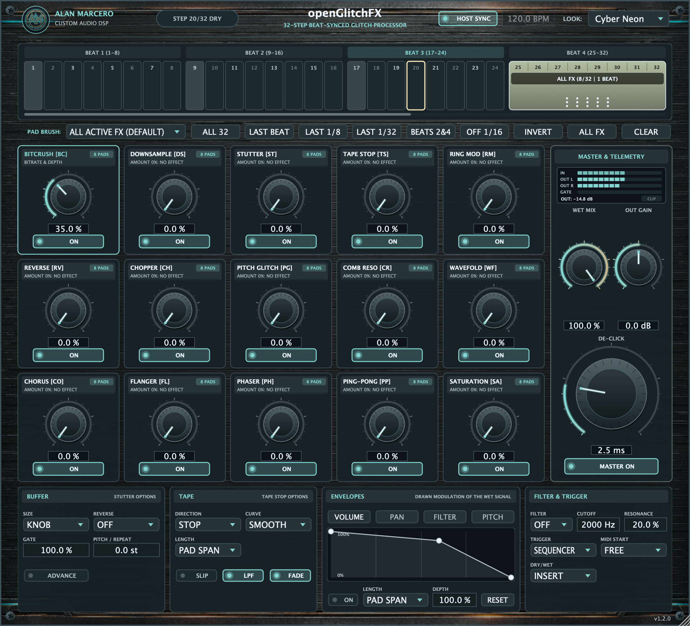
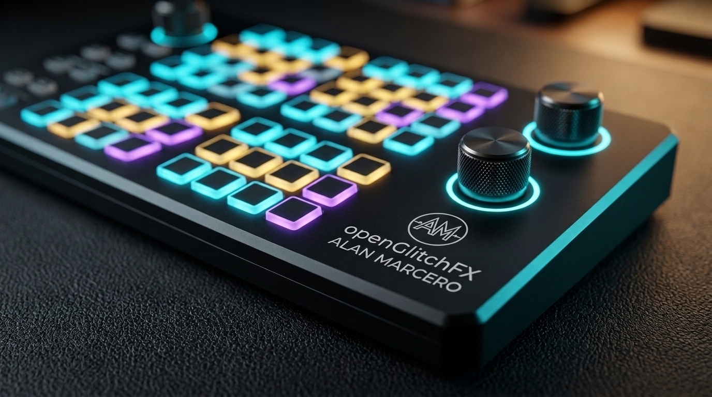
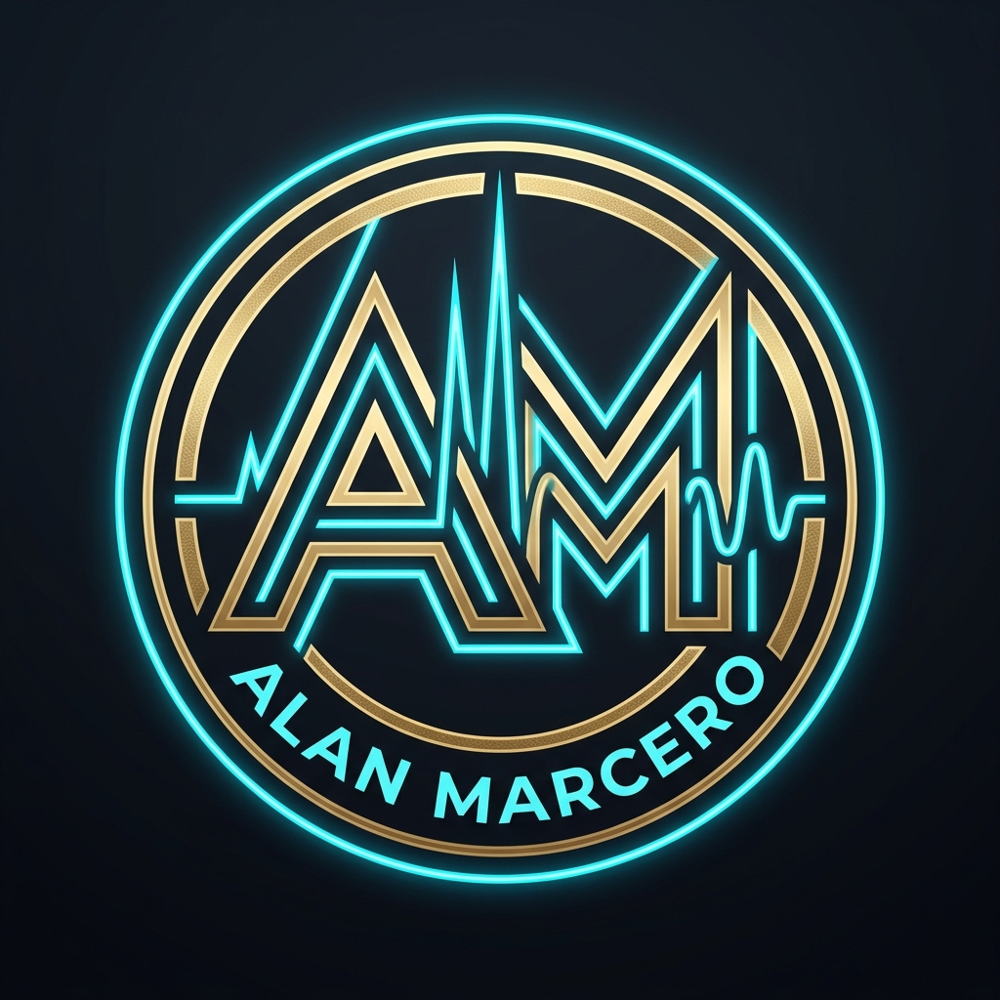

# openGlitchFX

[Install with OpenVST Manager](https://github.com/alanmarcero/alan-m-OpenVSTManager/releases/latest)



*Captured from the released v1.1.0 VST3 editor. [Capture details and provenance](docs/SCREENSHOTS.md).*

**openGlitchFX** is a beat-synchronized multi-glitch VST3 audio processor by **Alan Marcero**.

Unlike traditional glitch plugins that run continuously or require complex MIDI routing and automation lanes, **openGlitchFX** features an integrated **32-Step 4/4 Bar Beat-Synced Enable/Disable Sequencer**. Leave the plugin enabled on your drum bus, synth lead, or master track, and select any of the **32 spots in a 4/4 bar** (down to a single `1/32` note, the last beat of a bar, or custom rhythmic patterns) where the glitch engine engages—passing dry audio between active regions, with smoothing at transitions. Output trim still applies to the dry signal.

---

## Interface and themes

The native editor has four selectable color themes: **Cyber Neon** (default), **Industrial Amber**, **Acid Matrix**, and **Arctic Glitch**. The theme is saved with the session and can be automated.

### Hardware inspiration

These generated concept images show the hardware inspiration and branding; they are not plugin screenshots.

| Studio hardware concept | Alan Marcero emblem |
| :---: | :---: |
|  |  |

---

## Core Differentiator: 32-Step 4/4 Beat-Synced Sequencer & Per-Pad Effect Routing

- **32 Selectable Spots per 4/4 Bar & Automatic Contiguous Pad Merging:**
  - Every 4/4 bar (4 quarter-note beats) is subdivided into **32 steps** (`8 steps per beat × 4 beats = 32 steps`, each representing `1/32` of a bar).
  - **Continuous Multi-Pad Spanning (Zero `1/32` Resets):** When two or more adjacent pads are enabled with the same FX routing, **openGlitchFX** automatically combines them both **visually** (into a single unified glowing capsule block showing the combined duration such as `ALL FX (8/32 | 1 BEAT)` or `TAPE STOP (4/32 | 1/8 BAR)`) and **in the DSP engine**—the effect continues seamlessly across the entire combined block without resetting on every `1/32` subdivision!
  - Time-based processors (`TAPE STOP`, `REVERSE`, `STUTTER`) automatically scale their deceleration and buffer windows across the full combined multi-pad span and only trigger once at the start of the combined block.
- **Per-Pad (1/32 Step) Effect Assignment (Option 3: Hybrid Right-Click Menu + Pad Brush + 2×5 Mini LED Matrix):**
  - Each of the 32 pads stores its own **10-bit FX Routing Mask** (`step_fx_01` .. `step_fx_32`), backed by **10 independent smoothed DSP gate envelopes** so different pads or combined blocks can trigger completely different effects (e.g., *Bitcrush* on Pads 25–28, *Stutter* on Pads 29–31, and *Tape Stop* only on Pad 32).
  - **Right-Click Any Pad or Combined Block (Context Menu):**
    - **Enable ALL 10 FX (`ALL`)** or **Disable (Dry Pass-Through)** on the clicked pad or entire combined block.
    - **Solo Single Effect:** One-click soloing of any of the 10 FX (`Only BITCRUSH (BC)`, `Only TAPE STOP (TS)`, etc.) on that pad or combined block (automatically waking up the effect's dial to `50%` if currently at `0%`).
    - **Toggle Multi-FX Combination:** Check/uncheck any combination of the 10 effects.
    - **Split / Edit Single Pad Only:** Submenu to split an individual `1/32` pad out of a combined multi-pad block.
    - **Copy FX Routing:** Copy routing to the current 8-step beat or across all 32 pads.
  - **Left-Click `PAD BRUSH` Mode:**
    - Use the **`PAD BRUSH:`** dropdown (`ALL ACTIVE FX` or `ONLY: BITCRUSH [BC]` .. `ONLY: WAVEFOLD [WF]`) to left-click and drag-paint a specific effect across any pads in the bar—adjacent painted pads merge automatically!
  - **On-Pad Visual Feedback:**
    - Each pad or combined block displays a live routing & duration badge (`ALL FX (8/32 | 1 BEAT)`, `BC 2/32`, `TS`, `3FX`, etc.), a continuous playhead sweep across the merged block, and a **2×5 mini LED dot matrix** indicating which of the 10 effects are assigned.
- **One-Click Musical Pattern Presets:**
  - **ALL 32:** Continuous glitch processing across the entire bar.
  - **LAST BEAT (25-32):** Engages only on Beat 4 of every bar for automatic end-of-bar turnarounds and fills.
  - **LAST 1/8 (29-32):** Engages for the final 1/8 note (`4/32`) of the bar.
  - **LAST 1/32 (Step 32):** Micro-glitch burst on only the very last `1/32` note of the bar.
  - **BEATS 2&4:** Backbeat-synced glitching on snare beats.
  - **OFF 1/16:** The second 1/16 note of every 1/8 note.
  - **ALL FX / CLEAR:** Instant FX routing reset or pattern clear.
- **Sample-Accurate DAW Sync & Anti-Click Gate Envelope:**
  - Locks directly to the DAW host playhead (`PPQ` bar position and `BPM`) or runs on an internal BPM clock when host transport is stopped.
  - Adjustable **DE-CLICK** smoothing (`0.5 ms` to `25 ms`) reduces clicks when transitioning between dry pass-through and active glitch steps, or when switching between different effects on adjacent pads.
  - Automatically triggers buffer capture for time-based effects (`STUTTER`, `TAPE STOP`, `REVERSE`) on the exact sample **that specific effect's** pad assignment transitions from inactive to active.

---

## 10 Glitch FX Modules (Phase 1 + Phase 2)

Each of the **10 Glitch FX** features a dedicated **Amount Knob (`0% – 100%`)** and an independent **ON/OFF** toggle so you can dial in a single effect or stack multiple glitch processors in series:

### Phase 1 — Core 5 Glitch FX
1. **BITCRUSH (Bitrate & Depth Crusher):**
   - Continuously variable knob that dials bit resolution from pristine 16-bit down to gritty 1.5-bit quantization, paired with bitrate packet-hold frame decimation and tanh saturation compensation.
2. **DOWNSAMPLE (Sample Rate Decimator):**
   - Variable sample-and-hold clock divider (`1x` to `59x`) for authentic early-sampler aliasing and vocal/synth crunch.
3. **STUTTER (Beat Repeat / Buffer Stutter):**
   - Captures audio at the start of an active step region and loops a slice with smoothed edges. In KNOB mode, slice duration ranges from a quarter note (capped at 500 ms) down to 22 ms; BUFFER SIZE can select a fixed tempo division instead.
4. **TAPE STOP (Vinyl Brake):**
   - Simulates pressing a finger against a spinning tape reel or turntable platter, decelerating playback speed and pitch to a low-speed floor.
5. **RING MOD (Cybernetic Carrier Modulator):**
   - Exponentially swept sine-based carrier oscillator (`45 Hz` to `1600 Hz`) for metallic, robotic, and sci-fi harmonic textures.

### Phase 2 — 5 Additional Glitch FX
6. **REVERSE (Backwards Grain Player):**
   - Reads recorded dry-audio history backwards across the joined pad span within the available buffer, with raised-cosine fades at the span boundaries. On a cold start it first fills a short buffer.
7. **CHOPPER (Rhythmic Slicer Gate):**
   - Tempo-scaled raised-cosine gate. Amount changes rate, depth and shape; longer joined pad spans slow the gate, and high amounts add a stereo phase offset.
8. **PITCH GLITCH (Octave & Fifth Arpeggiator):**
   - Dual-head crossfaded granular pitch shifter that cycles toward `+7`, `+12`, `-12`, and `+19` semitones. Full Amount reaches those intervals; lower settings reduce the shifts.
9. **COMB RESO (Metallic Feedback Resonator):**
   - Short-delay (`1.4 ms` to `14 ms`) high-feedback comb filter with soft-clipped feedback loop for metallic flanging and tuned tube resonances.
10. **WAVEFOLD (Harmonic Digital Wavefolder):**
    - Sine-based harmonic wavefolder with first-order antiderivative anti-aliasing, DC blocking and tone filtering.

---

## Buffer, Tape, Envelopes & MIDI (Phase 3)

The panel below the FX cards adds four groups of controls.

- **BUFFER (STUTTER options):**
  - **SIZE:** `KNOB` lets the STUTTER amount set the slice. `1/4` to `1/64` locks the slice to the tempo.
  - **REVERSE:** `OFF`, `ALL` repeats, or `ALTERNATE` repeats.
  - **GATE:** The audible part of each repeat (`5%` to `100%`).
  - **PITCH / REPEAT:** Pitch change per repeat (`-12` to `+12` semitones).
  - **ADVANCE:** Each repeat starts half a slice later, so the stutter moves forward through the audio.
- **TAPE (TAPE STOP options):**
  - **DIRECTION:** `STOP` slows the tape toward its low-speed floor. `START` ramps from that floor to normal speed.
  - **CURVE:** `SMOOTH` ramp or `STEPPED` (8 speed steps).
  - **LENGTH:** `PAD SPAN` or a fixed note length (`1/32` to `1 BAR`).
  - **SLIP:** Wow and flutter. **LPF:** Highs roll off as the tape slows. **FADE:** Volume drops as the tape slows.
- **ENVELOPES:** Four drawn envelopes (`VOLUME`, `PAN`, `FILTER`, `PITCH`) shape the wet signal.
  - Click to add a point, drag to move it, double-click or right-click to delete it. `RESET` restores the default shape.
  - **LENGTH:** `PAD SPAN` runs the envelope once across each block of joined pads. A note value loops it in time with the song.
  - `PITCH` changes the STUTTER playback pitch by up to one octave. `FILTER` moves the cutoff down by up to 8 octaves.
  - The session saves the drawn points.
- **FILTER & TRIGGER:**
  - **FILTER:** Low-pass or high-pass state-variable filter on the wet signal, with `CUTOFF` and `RESONANCE`.
  - **TRIGGER:** `SEQUENCER` uses the 32 pads. `MIDI` ignores the pads: notes `60`-`69` trigger one FX each (BITCRUSH to WAVEFOLD), and any other note triggers all FX.
  - **MIDI START:** `FREE` starts on the note. `SYNCED` waits for the next `1/32` step.
  - **DRY/WET:** `INSERT` replaces the dry signal on active pads. `PARALLEL` keeps the dry signal and adds the glitch on top.

Hover over any control for a tooltip.

---

## Project Structure

```
openGlitchFX/
├── .github/
│   └── workflows/
│       └── build.yml                  # macOS Universal + Windows MSVC CI, CTest & pluginval
├── assets/
│   ├── alan_marcero_logo.jpg          # Custom Alan Marcero emblem (embedded in plugin & README)
│   ├── analog-cyber-faceplate.png      # Generated machined-metal texture (embedded in BinaryData)
│   ├── native-ui.png                  # Released VST3 editor capture
│   └── studio_hardware.jpg            # Studio hardware macro concept shot
├── Source/
│   ├── Core/                          # Pure C++20 DSP engine (zero GUI dependencies)
│   │   ├── BeatStepSequencer.h/.cpp   # 32-step 4/4 bar PPQ sync & anti-click gate envelope
│   │   ├── GlitchEffects.h/.cpp       # All 10 DSP glitch effect processors + wet filter
│   │   ├── ModEnvelope.h/.cpp         # Drawn n-point modulation envelopes
│   │   └── GlitchProcessorCore.h/.cpp # Master glitch chain & telemetry
│   └── Plugin/                        # JUCE 8 VST3 Plugin & GUI
│       ├── Parameters.h/.cpp          # APVTS layout (32 steps + 10 FX + master controls)
│       ├── GlitchLookAndFeel.h/.cpp   # 4 selectable themes & custom rotary/button rendering
│       ├── StepSequencerComponent.h/.cpp # Interactive 32-step 4/4 beat grid UI
│       ├── DetailPanelComponent.h/.cpp   # Buffer, tape, envelope, filter & trigger controls
│       ├── EnvelopeEditorComponent.h/.cpp # Breakpoint envelope editor
│       ├── PluginProcessor.h/.cpp     # JUCE AudioProcessor & playhead integration
│       └── PluginEditor.h/.cpp        # 10-FX 2x5 matrix + 32-step sequencer editor
├── Tests/                             # Catch2 unit test suite
│   ├── BeatSequencerTests.cpp
│   └── GlitchCoreTests.cpp
├── CMakeLists.txt
├── LICENSE
└── README.md
```

---

## Install

1. Download and install [OpenVST Manager](https://github.com/alanmarcero/alan-m-OpenVSTManager/releases/latest) for macOS or Windows.
2. Open the manager and refresh the catalog.
3. Choose **openGlitchFX**, select **VST3**, and install.
4. Rescan plugins in your DAW. If you chose a custom install folder, add it to the DAW's search paths.

Manual downloads: [v1.1.1 release](https://github.com/alanmarcero/openGlitchFX/releases/tag/v1.1.1). Packages contain **VST3 only** for macOS 11+ (universal Apple Silicon/Intel) and Windows x64. Extract and copy the entire `openGlitchFX.vst3` bundle to `~/Library/Audio/Plug-Ins/VST3/` on macOS or `C:\Program Files\Common Files\VST3\` on Windows, then rescan your DAW. macOS builds are signed ad hoc.

## Building & Testing

### Prerequisites

CMake 3.22+, Git, and a C++20 compiler (Xcode command-line tools on macOS or Visual Studio 2022 C++ tools on Windows). The first configure downloads JUCE 8.0.9 and Catch2 3.9.1.

### Build Commands
```bash
cmake -S . -B build -DCMAKE_BUILD_TYPE=Release
cmake --build build --config Release --parallel
ctest --test-dir build -C Release --output-on-failure
```

Outputs are in `build/openGlitchFX_artefacts/Release/VST3/`. Add `-DCMAKE_OSX_ARCHITECTURES="arm64;x86_64" -DCMAKE_OSX_DEPLOYMENT_TARGET=11.0` when configuring a universal macOS build; use `-A x64` with the Visual Studio generator on Windows. CI builds and validates the VST3 on macOS and Windows.

---

## License

MIT License. Copyright (c) 2026 Alan Marcero.
