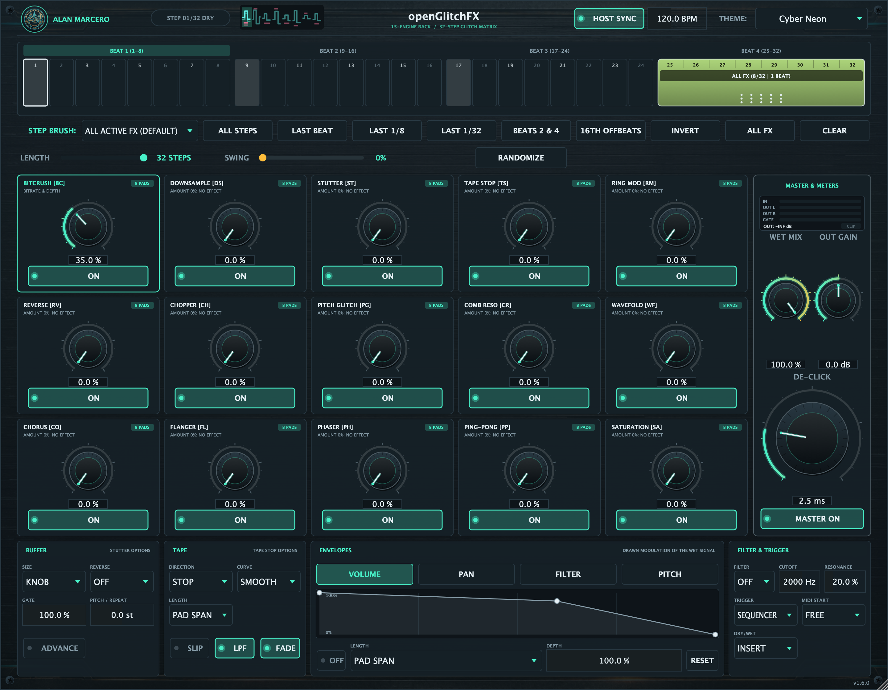

# Native UI screenshot

Captured on macOS from the v1.6.0 Release editor in Cyber Neon. The eight-slice waveform appears between the step indicator and the rack title. The 1440 × 1120 editor was rendered at 2× scale (2880 × 2240).

The native GUI test also checks the default and minimum sizes, all four theme menus, and how the waveform responds to transport changes at 48 and 96 kHz. All 49 local CTest cases passed.

Screenshot SHA-256: `a6e931db981dd6687bfd8633fc7a5f99f1c21ad6ffd562b52ccd230293524936`.
